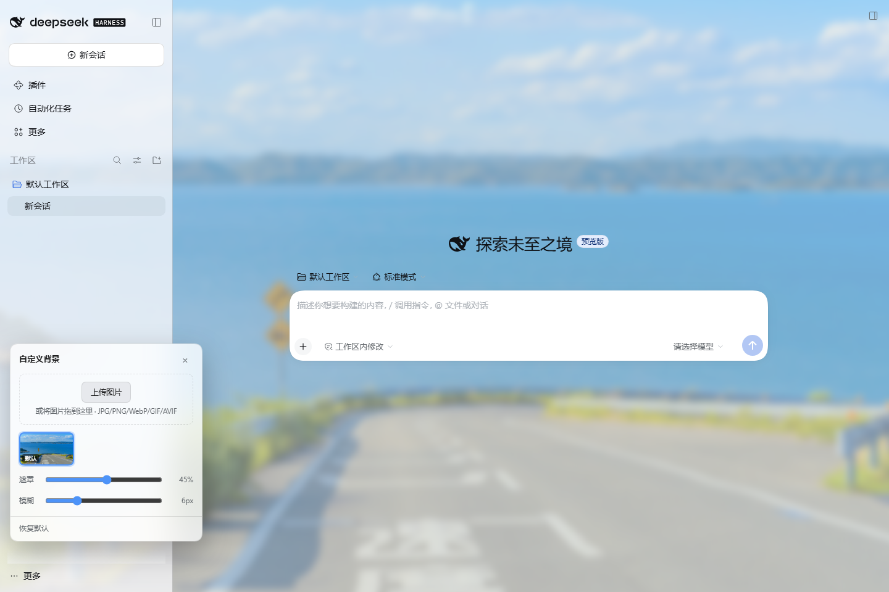
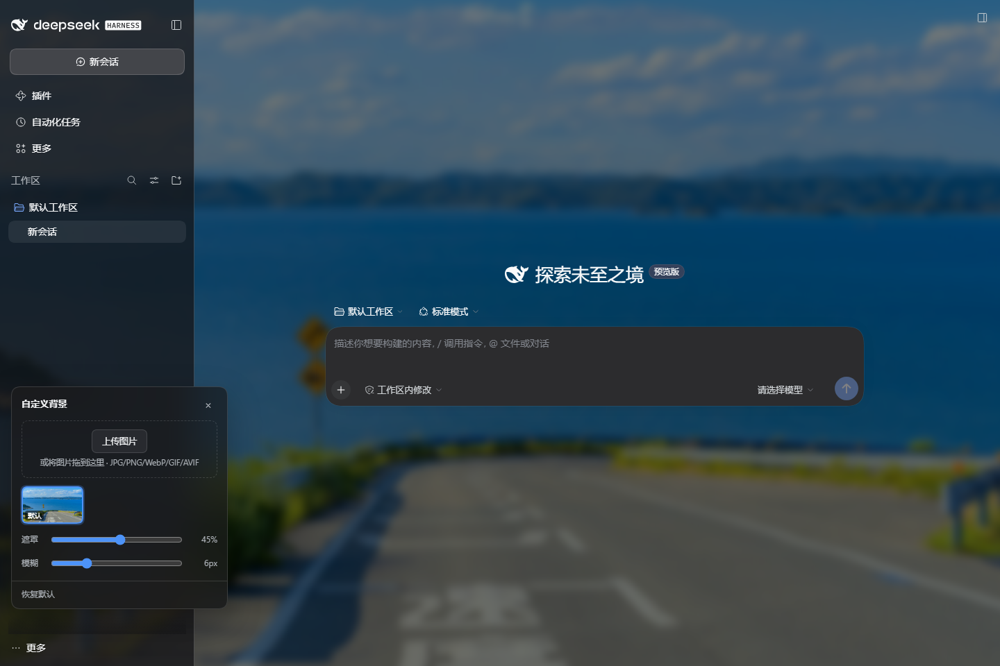
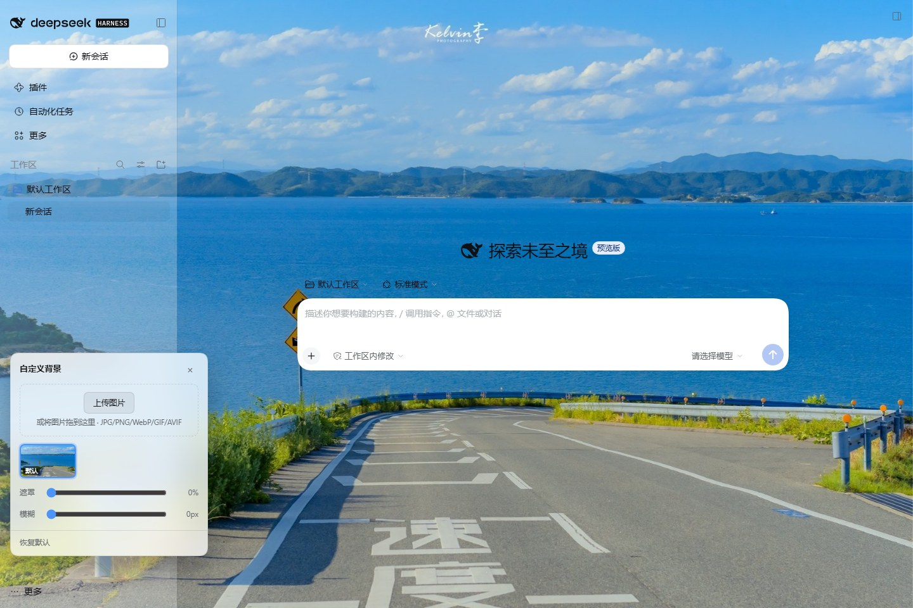

# dsh-plugin-custom-bg · 自定义背景

[English](README.md) | 中文

给 DeepSeek Harness 换一张自己的壁纸。左下角一个浮窗，点开就能上传图片、在已上传的几张里切换、调遮罩和模糊；默认背景是包内的 `imgs/default.jpg`，装上就有背景，不配置也能用。



## 特性

- **左下角浮窗**——默认是一个 44px 的圆钮，点开是 312px 的面板；不占布局、不挡内容，收起状态只留一个图标
- **默认背景随包分发**——`imgs/default.jpg` 开箱即用，Host 直接从包里读，不依赖网络
- **上传即生效**——面板里选文件，或者把图片拖进面板；支持 JPG / PNG / WebP / GIF / AVIF，单张上限 24 MB
- **多图留档**——上传过的图片都在面板里以缩略图排列，点一下即切换，悬停可删除；重复上传同一张图片只占一份
- **遮罩与模糊**——两档滑块解决「壁纸太花看不清字」：遮罩 0–85%，模糊 0–24px。遮罩同时决定侧栏与标题栏的不透明度：拉到 0 时它们一起让开，壁纸铺满整窗，而不只是聊天区
- **跟随浅色 / 深色主题**——遮罩颜色随主题在白色与黑色之间切换，面板本身也是主题化的毛玻璃
- **跨刷新持久化**——选中的图片、遮罩、模糊都存在 `$DSH_HOME/plugin-data/dsh-custom-bg/state.json`
- **无第三方依赖**——Host 只用了 Node 内置模块，浏览器半侧是原生 DOM，没有 React、没有打包器



遮罩与模糊都拉到 0：侧栏、标题栏、聊天区一起透明，壁纸保持原始清晰度。



## 安装

### 插件市场（推荐）

在 **插件 → 插件市场** 里搜索 `custom-bg` 或「背景」，点安装。装好后刷新页面，左下角会出现背景圆钮。

上架物料都在 [`market/`](market/README.md)：`index.json` 是可以直接加进「发现 → 索引源」的插件市场索引（现在就能搜到、装上），`awesome-dsh-plugin.yml` 是提进官方精选列表的那一个文件。

### 命令行

```sh
dsh plugin --profile web add dsh-plugin-custom-bg
```

`web` 换成宿主实际使用的 profile 名。装完重启 `dsh web`。

### 从 GitHub 直接装

```sh
dsh plugin --profile web add "git+https://github.com/wuqiwenpk/dsh-custom-bg.git"
```

## 使用

1. 点左下角的背景圆钮，面板展开
2. **上传图片**——点「上传图片」选文件，或直接把图片拖到面板上；上传完成后立即成为当前背景
3. **切换**——点面板里的缩略图；「默认」那张是包内背景
4. **调参**——拖「遮罩」压暗或提亮背景，拖「模糊」让壁纸退到后面去
5. **恢复默认**——面板左下角的「恢复默认」回到 `default.jpg`
6. **收起**——点右上角 × 或按 `Esc`；面板的开合状态会被记住

壁纸铺满整页，侧栏与聊天区都透出背景，卡片、输入框等前景保持原有的不透明表面，保证可读性。

## 数据与配置

| 项 | 位置 |
|---|---|
| 上传的图片 | `$DSH_HOME/plugin-data/dsh-custom-bg/<id>.<ext>` |
| 选中项与滑块 | `$DSH_HOME/plugin-data/dsh-custom-bg/state.json` |
| 内置默认背景 | 包内 `imgs/default.jpg` |

`$DSH_HOME` 默认是 `~/.dsh`，可用同名环境变量覆盖。卸载插件不会删除这份数据，删掉目录即可清理。

插件支持两个可选配置字段，写进 profile 的 `cordis.patch.yml` 即可：

```yaml
- id: custom-bg
  config:
    dataDir: D:/my-data/custom-bg   # 覆盖默认数据目录
    dshHome: D:/my-dsh-home         # 覆盖 $DSH_HOME 的推断
```

## HTTP 接口

Host 在 `/custom-bg` 前缀下注册以下路由，供浏览器半侧使用（也可被脚本直接调用）：

| 方法 | 路径 | 说明 |
|---|---|---|
| GET | `/custom-bg/api/state` | 当前状态：选中的图片、图片列表、遮罩与模糊 |
| GET | `/custom-bg/image/<id>.<ext>` | 图片字节，长缓存 |
| POST | `/custom-bg/api/upload` | 请求体是图片字节，`x-file-name` 可选；上传并设为当前 |
| POST | `/custom-bg/api/select` | `{"id": "..."}` |
| POST | `/custom-bg/api/delete` | `{"id": "..."}`，内置背景不可删除 |
| POST | `/custom-bg/api/settings` | `{"scrim": 0..0.85, "blur": 0..24}`，越界会被夹到范围内 |

请求只接受同源来源：`Sec-Fetch-Site: cross-site` 或跨站 `Origin` 一律 403；上传按文件头校验真实格式，不是图片就 415。

## 兼容性

- 需要 DSH `0.2.x`（`web` 载体：`@deepseek-ai/dsh-host-webserver` + 客户端模块系统）
- 纯桌面壳自有载体（`file://` 加载、IPC fetch）不属于本插件覆盖范围；桌面端走 `dsh web` 本地 HTTP 时工作正常

## 常见问题

- **壁纸不显示**——如果同时装了别的主题/外观插件，它可能把 `--dsw-alias-bg-base` 又改回去了，两个插件都在改同一个变量，留下一个即可
- **面板为什么不在最底边**——左下角浮窗往上提了 82px，正好避开侧栏底部的「设置 / 更多 / 账号」一排，不收起来也点得到它们
- **上传失败**——本地会按文件头校验格式，改过扩展名的文件会被拒（415）；单张上限 24 MB
- **换机器不想带壁纸**——删掉 `$DSH_HOME/plugin-data/dsh-custom-bg/` 即可，插件会回到内置默认背景

## 开发

仓库里 `lib/` 就是源码，没有构建步骤：`lib/index.js` 是 Host 半侧，`lib/client.js` 是浏览器半侧（自带 `window.__ModuleLoader__` 外壳）。

```sh
# 语法检查
npm run check

# Host 半侧离线冒烟测试（临时目录里跑完整增删改查，不需要启动 DSH）
npm run smoke

# 装进一个临时 profile 试跑
dsh --profile cb-test --from-default-profile web --dump-config
dsh plugin --profile cb-test add link:$PWD
dsh --profile cb-test web --port 43301
```

## 许可

MIT
